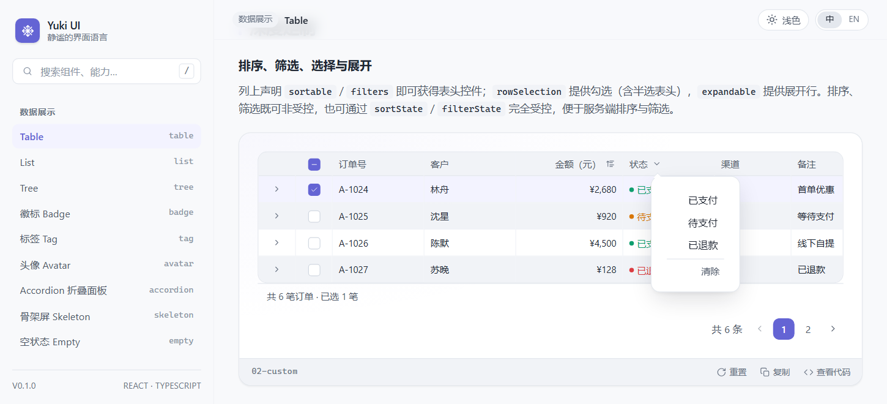

# Yuki UI

Yuki UI 是一套面向 React 和 TypeScript 的组件库。冷石墨灰构成界面底色，鸢尾紫标记主要操作与选中状态，间距按 4px 节奏排列。从一个输入框到带筛选、行选择和文件预览的工作台，都可以沿用同一套明暗主题。

[AI 组件使用指南](./AI-GUIDE.md) · [可运行的组合示例](./apps/docs/src/examples/recipes) · [设计令牌](./packages/ui/src/styles/tokens.css)



## 可以用它构建什么

| 场景 | 组件与用法 |
| --- | --- |
| 编辑表单 | 在 `Form.Item` 中放入 `Input`、`Select` 和日期控件。字段支持校验、跨字段依赖，`Form.List` 用于可增删和排序的多行输入。 |
| 数据工作台 | `Table` 支持排序、列筛选、行选择、展开和固定行高虚拟滚动。`Table`、`List` 与独立的 `Pagination` 共用页码和页容量接口。 |
| 内容审阅 | `Upload` 接收文件，`ContentRenderer` 根据明确的类型展示文档、代码、Markdown、图片或音视频。`DocumentViewer` 可从 URL 或本地文件读取 PDF 和 DOCX。 |
| 页面结构与反馈 | 用 `Grid`、`Flex`、`Card` 组织页面，用 `Accordion` 和 `Tabs` 分区。行内操作可用 `Dropdown`，编辑流程可用 `Dialog`，提交结果可用 `Alert` 或 `ToastProvider`。 |

## 本地体验

开发环境需要 Node.js 22.13 或更高版本。在仓库根目录运行以下命令，再打开 [本地文档站](http://localhost:5178)。

```bash
npm ci
npm run dev
```

文档站包含交互示例、可复制的 TSX 源码和主题预览。可以直接体验在对话框中创建项目、搜索分页表格、本地文件预览这三个完整流程。[组合示例](./apps/docs/src/content/开始/recipes.md)

## 接入 React 项目

组件包名为 `@yuki-ui/react`，React 与 React DOM 的 peer 版本范围为 `^18.3.0 || ^19.0.0`。从此仓库接入时，先构建并生成可安装的包。

```bash
# 在本仓库根目录
npm run build:lib
npm pack -w @yuki-ui/react

# 在使用组件库的 React 项目中，将路径替换为上一步输出的文件
npm install /path/to/yuki-ui-react-0.1.0.tgz
```

在应用入口引入一次样式。下面的筛选栏由父组件持有选中的团队，用一个 `multiple` 字段启用多选标签。切换到单选时取值类型为单个选项值或 `null`。

```tsx
import { useState } from 'react';
import { Button, ConfigProvider, Flex, Select } from '@yuki-ui/react';
import '@yuki-ui/react/styles.css';

const teams = [
  { value: 'design', label: '设计' },
  { value: 'engineering', label: '研发' },
];

export default function TeamFilter() {
  const [selected, setSelected] = useState<string[]>([]);

  return (
    <ConfigProvider theme={{ mode: 'system' }} locale="zh-CN">
      <Flex direction="column" gap="3">
        <Select
          label="参与团队"
          multiple
          searchable
          options={teams}
          value={selected}
          onChange={setSelected}
        />
        <Button variant="outline" disabled={!selected.length} onClick={() => setSelected([])}>
          重置筛选
        </Button>
      </Flex>
    </ConfigProvider>
  );
}
```

安装后的包随附完整 AI 指南，可用 `node -p "require.resolve('@yuki-ui/react/ai-guide.md')"` 定位文件。每个组件条目都包含用法、TSX 示例和字段签名，可供编辑器中的 AI 离线读取。

组件提供 ESM 和 TypeScript 声明。支持从包根具名导入，也可以从 `@yuki-ui/react/components/select` 等组件子路径导入。`styles.css` 包含设计令牌和全部组件样式，只复用 CSS 变量时可单独引入 `@yuki-ui/react/tokens.css`。

## 主题与定制

`ConfigProvider` 管理主题、语言、密度和浮层挂载点。将它嵌套在页面局部即可给子树设置独立主题。品牌色、间距和圆角使用 CSS 变量，单个组件可以通过自身支持的语义槽或节点属性微调。

```tsx
import { Button, ConfigProvider } from '@yuki-ui/react';

export function ReviewAction() {
  return (
    <ConfigProvider
      global={false}
      theme={{ mode: 'dark', primaryColor: '#8f8ff2' }}
      density="compact"
    >
      <Button variant="soft" tone="primary" classNames={{ label: 'review-label' }}>
        查看审阅记录
      </Button>
    </ConfigProvider>
  );
}
```

内置文案支持简体中文和英文。键盘交互、焦点管理、低动态偏好和虚拟滚动的适用范围，可查阅各组件说明。[组件文档](./apps/docs/src/content)

## 维护与验证

| 命令 | 用途 |
| --- | --- |
| `npm run check` | 检查组件库和文档站类型，核对 AI 指南与源码签名 |
| `npm run gen` | 更新公共导出、样式入口与文档站统计 |
| `node scripts/ai-guide.mjs --check` | 核对 AI 指南与源码签名。更改公开 API 后，去掉 `--check` 可刷新参考段落 |
| `npm run build` | 生成组件包 `packages/ui/dist/` 与可部署到静态站点的 `site-dist/` |

组件实现在 [packages/ui](./packages/ui)，文档站在 [apps/docs](./apps/docs)。工作台的键盘导航、异步反馈、数据展示与长列表续载等设计参考见 [React 组件清单对照](./docs/react-component-survey.md)。

## 许可证

[MIT](./LICENSE)
